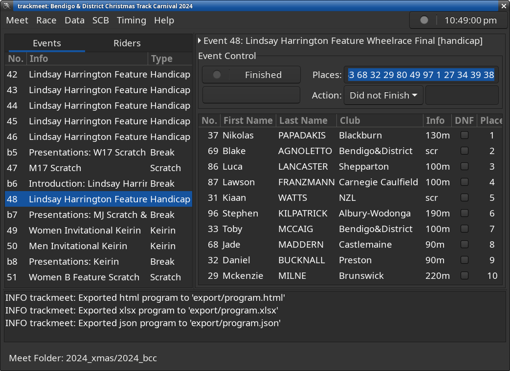

# metarace-trackmeet

Archived: 2026-05-14
Moved to: https://codeberg.org/ndf-zz/metarace-trackmeet

Timing and result application for UCI Part 3 Track Races.

Shared installation script:
[metarace-install](https://6-v.org/software/install.html).

## Usage

Choose meet folder and open:

	$ trackmeet

Open an existing track meet:

	$ trackmeet PATH

Create empty meet folder and open it:

	$ trackmeet --create

Edit default configuration:

	$ trackmeet --edit-default

## Standards

Standard track meet competitions are enabled by importing a list
of category standards for the meet. Reference standards for 
Australian domestic meets are provided at the following URL:

[https://6-v.org/au/](https://6-v.org/au/)

To enable standard competitions, check the source urls in
Meet->Properties->Standards, then import to the current meet
via Data->Update Standards.

Note: Keirin progressions and Omnium competitions are not yet complete
in the current release (1.13.11).

## Support

   - Signal Group: [metarace](https://signal.group/#CjQKII2j2E7Zxn7dHgsazfKlrIXfhjgZOUB3OUFhzKyb-p_bEhBehsI65MhGABZaJeJ-tMZl)
   - Issues: [issues](https://codeberg.org/ndf-zz/metarace-trackmeet/issues)

## Requirements

   - Python >= 3.11
   - PyGObject
   - Gtk >= 3.22
   - metarace >= 2.1.23
   - tex-gyre fonts (optional, recommended)
   - evince (optional, recommended)
   - rsync (optional)
   - mosquitto (optional)

## Post-Installation Notes

Optionally configure defaults for new meets and library options:

	$ ~/Documents/metarace/venv/bin/trackmeet --edit-default

### KDE/Plasma (Wayland)

KDE Plasma will incorrectly mask
function key modifiers, rendering trackmeet action
keys unusable. The workaround is to remove any keyboard shortcuts
for Fn or Ctrl+Fn keys in Settings - Keyboard - Shortcuts.

Debugging messages are sent to the systemd journal,
view with journalctl:

	$ journalctl -f

### Gnome Desktop (Wayland/X11)

By default, Gnome uses a system font which does not have
fixed-width digits. As a result, rolling times displayed
in trackmeet will jiggle left and right as the digits change,
and right-aligned time columns will not align correctly
at the decimal point.

To correct this, install gnome-tweaks and change the
system font to one with fixed-width digits eg:
Noto Sans Regular.

Debugging messages are sent to the systemd journal,
view with journalctl:

	$ journalctl -f

### XFCE4/labwc (Wayland)

Remove any `C-Fn` or `Fn` key mappings from the Labwc
configuration file `~/.config/xfce4/labwc/rc.xml` under
`<keyboard><keybind key=...>` elements.

Debugging messages are appended to ~/.xsession-errors,
view with tail:

	$ tail -f ~/.xsession-errors

### XFCE4 (X11)

Under Settings, Window Manager, Keyboard, locate the
"Workspace N" entries and clear the shortcuts for each one by
selecting the "Clear" button.

Debugging messages are appended to ~/.xsession-errors,
view with tail:

	$ tail -f ~/.xsession-errors

## Manual Installation

Install system requirements for your OS
then prepare a metarace runtime directory
and virtual env as follows:

	$ mkdir -p ~/Documents/metarace
	$ python3 -m venv --system-site-packages ~/Documents/metarace/venv

Use pip in your virtual env to download and install
trackmeet along with any required python packages
from the Python Package Index:

	$ ~/Documents/metarace/venv/bin/pip3 install metarace-trackmeet

Create a new empty trackmeet:

	$ ~/Documents/metarace/venv/bin/trackmeet --create
